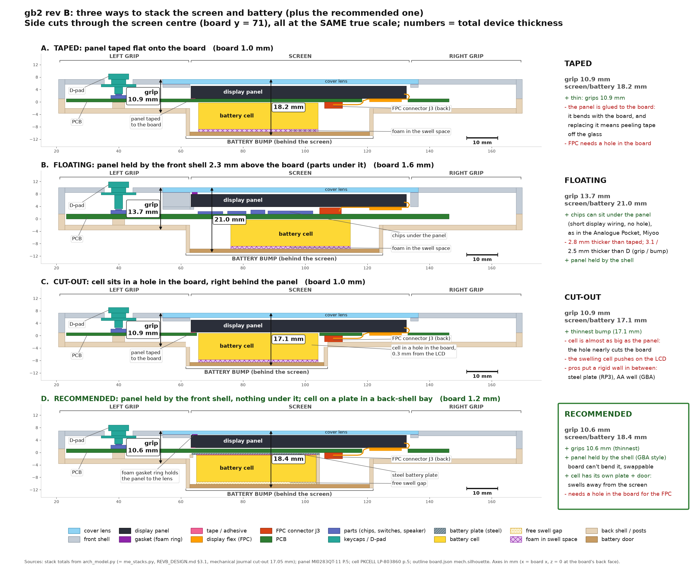
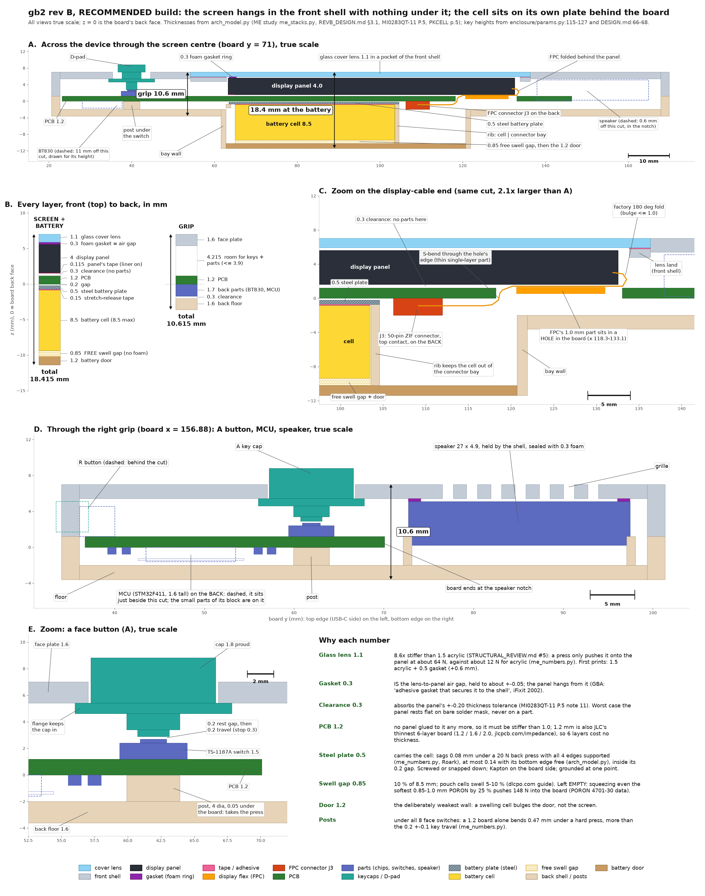
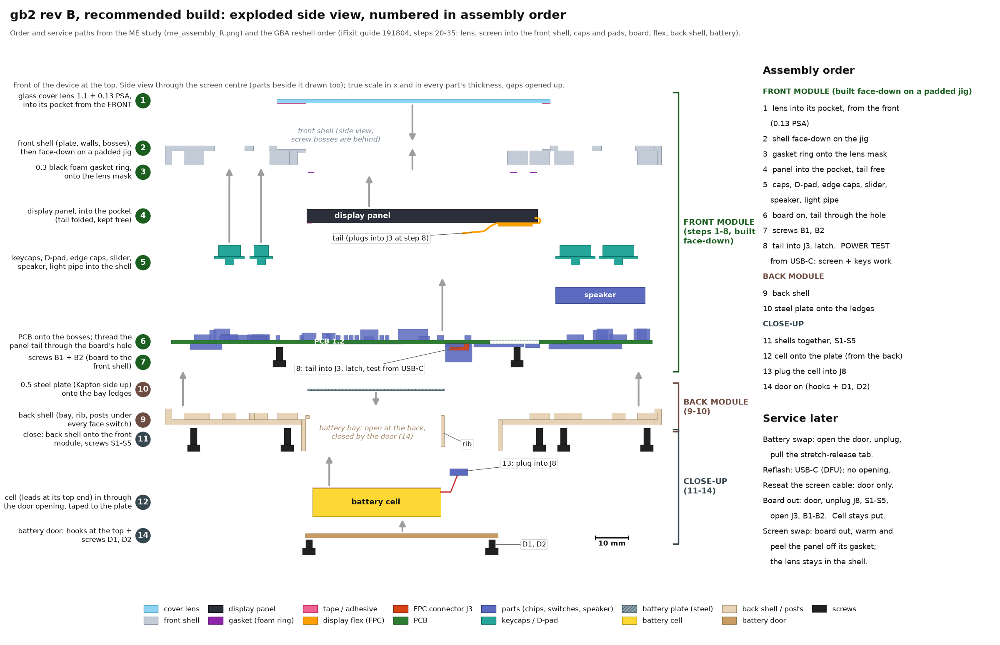
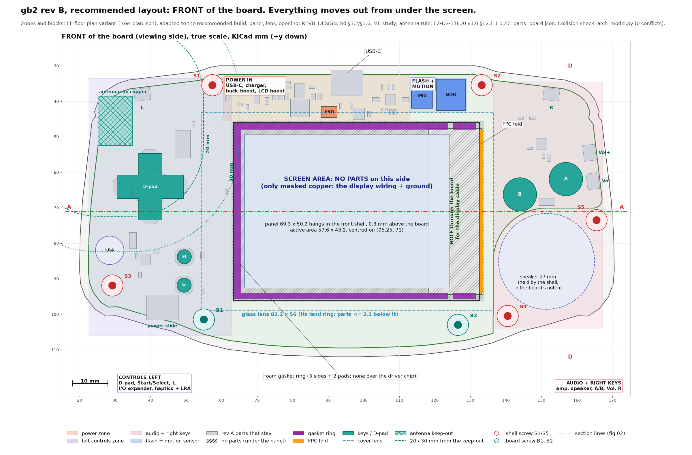
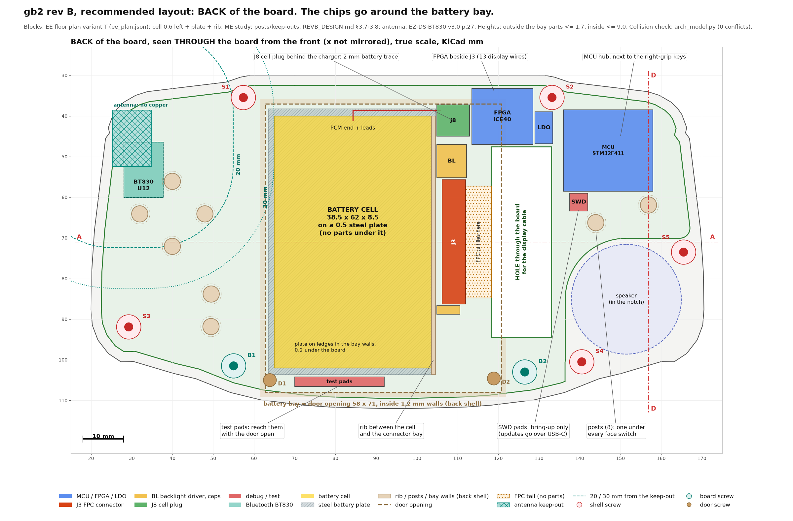

# gb2 rev B: how a professional ME and EE would lay out the device

**Short answer.** Hold the screen in the housing and never on the main board, as every handheld in the teardown
survey does, and keep the board under it clear, as the GBA and DS Lite do:

1. **The screen hangs in the front shell, not on the board.** The bare 1774 panel (MI0283QT-11) sits in a pocket of
   the front shell. A thin black foam gasket ring holds it to the back of a glass cover lens.
2. **Nothing sits on the board under the screen.** The board runs flat behind the panel with a 0.3 mm gap. Every chip
   that used to be there moves to the board's edges or to its back.
3. **The battery lives in its own compartment.** It sits behind the board in a bay in the back shell, taped to its own
   thin steel plate. Behind it is an empty swell gap and then a GBA-style door.

The result is **10.6 mm at the grips and 18.4 mm at the battery bump**. That is about as thin as taping the panel to
the board (10.9 / 18.2), and 3.1 mm thinner at the grips and 2.5 mm thinner at the bump than floating the panel over
parts (13.7 / 21.0). The difference from taping is that nothing you do to the board can bend, load or glue up the
screen. The battery, the board and the screen can each come out on their own.

Electrically, the price is that the MCU and FPGA move off the middle of the board, so the display wiring gets longer
and two narrow board paths get crowded. A **6-layer, 1.2 mm board** fixes that, and it costs no extra thickness because
the mechanical design wants 1.2 mm anyway.

Every picture below is drawn to scale from the real board outline (`enclosure/build/board.json`) and the stack model
in `arch_model.py`. Rev A (ordered) is unchanged, and no KiCad file was touched.

---

## 1. The options, side by side

*Side cuts through the screen centre, all four at the same scale. The green box is the recommendation.*

| | Taped (A) | Floating (B) | Cut-out (C) | **Recommended (D)** |
|---|---|---|---|---|
| Grip thickness | 10.9 mm | 13.7 mm | 10.9 mm | **10.6 mm** |
| Screen + battery thickness | 18.2 mm | 21.0 mm | 17.1 mm | **18.4 mm** |
| What holds the screen | conductive tape on the board | front shell | tape on the board | **front shell (gasket to the lens)** |
| Parts under the screen | none | chips up to 2.0 mm | none (it's a hole) | **none** |
| Battery swelling pushes on | foam, then the board, then the screen | foam, then the board | **the LCD directly** | **an empty gap, then the door** |
| Hole in the board | 14.8 x 46.9 mm, for the FPC | none | the cell window plus the FPC | 14.8 x 46.9 mm, for the FPC |
| Board | 4-layer 1.0 | 4-layer 1.6 | 4-layer 1.0 | **6-layer 1.2** (4-layer works, with care) |

All thicknesses come from `arch_model.py`. They match the ME study (`me_stacks.py`), REVB_DESIGN.md §3.1 and the
cut-out figure of 17.05 mm in the mechanical journal (`/tmp/revb-arch/journal_mechanical.txt:9`). For scale, the GBA
and rev A are both 24.5 mm (board.json `mech.gba_depth`).

Why not the others:

- **Taped (A)** is thin, but the panel becomes part of the board.
  - It bends whenever the board bends. The maker says to mount it "free of twisting, warping and distortion" and not
    to "apply excessive force to the display surface or the adjoining areas" (MI0283QT-11 datasheet P.28, items 8
    and 3).
  - Swapping a panel means peeling conductive tape off glass.
  - The tape is conductive, so no copper can be exposed under it.
  - The lens gap is the leftover of a five-part tolerance chain, so it needs 0.5 mm worst case / 0.7 nominal
    (DESIGN.md:60-61).
- **Floating (B)** is what the EE prefers: chips can sit in the middle, the display wiring is about 11 mm with no
  layer changes, and the board needs no hole. It is also a professional pattern: the Analogue Pocket and Miyoo Mini
  put their SoC on the board under a shell-held screen (iFixit 163397 s17, 149516 s14 photos).
  - But it is 3.1 mm thicker at the grips and 2.5 mm thicker at the bump than the recommendation (2.8 mm thicker
    than taped, everywhere).
  - About 1.9 mm of that is the parts gap itself. The rest comes from the floating study's 1.6 mm board and its
    acrylic lens. With the recommendation's board, lens and battery bay, floating would be 12.5 / 20.3 mm
    (`arch_model.py`).
  - The placement study showed the board doesn't need that space: its fullest zone is 55 % used
    (`/tmp/revb-arch/journal_placement.txt`, zone table).
- **Cut-out (C)** saves only 1.1 mm. The cell (62 x 38.5) is nearly as big as the panel (69.3 x 50.2), so the hole
  nearly cuts the board in two, and a swelling cell presses straight on the LCD. Professionals only put cells in a
  board window with a rigid wall between them and the LCD: the Retroid Pocket 3's steel midframe, or the moulded AA
  well that comes up through the GBA's U-shaped board (see §2). That wall uses up most of the thickness the cut-out
  was meant to save.

## 2. What the professionals actually do

From 11 professionally engineered handhelds, mostly iFixit teardowns. Guide URL pattern:
`https://www.ifixit.com/Guide/x/<id>`; step numbers from the teardown study, and the step photos are in
`/tmp/revb-arch/img/`. The thickness chart and the sketches of the three internal patterns from that study are
`fig1_thickness_by_architecture.png` and `fig2_teardown_architectures.png` in this folder. Their letters A/B/C name
those patterns, not the options A-D in §1.

| Device (thickness) | Screen held by | Battery | Source |
|---|---|---|---|
| GBA (24.5) | an "adhesive gasket that secures it to the shell". A foam pad covers the LCD's back, and the U-shaped board lies on it | AA well that comes up through the notch of the U-shaped board, right behind the foam pad; door | iFixit 2002 s2-3, s12 (photos), s15-17 |
| GBA SP (24.4 closed) | clamped in the lid, foam side up | moulded well, door with a captive screw | iFixit 103533 s19-26, 12567 s2-4 |
| DS Lite (21.5) | the case. An insulator on the panel back stops it shorting the board | under a door | iFixit 4785 s17/s20, 4562 s1-2 |
| Analogue Pocket (21.8) | "strong adhesive" to the front shell | plastic tray clipped into the rear shell, with a connector | iFixit 163397 s20-31, 163329, 163330 |
| Miyoo Mini (18) | laminated screen in the front cover | compartment behind a cover, unplugs, no glue | iFixit 149516 s7-8, s16 |
| Switch Lite (14) | glued to the glass in the front frame | beside the board on a midframe | iFixit 137376 s52-58, 126223 s5 |
| Retroid Pocket 3 (24.2) | metal midframe, 10 screws | **in a window in the board, on that metal midframe, under a metal cover** | iFixit 171361, 172020 s3-20 |

What they all share:
- None of them uses the main board to hold the display.
- None of them lets the cell touch loose components.
- Button force goes into a stiff board screwed close to the keys, or into a midframe.

Where they differ is the board under the screen:
- **Clear:** the GBA and DS Lite have only a foam pad or insulating film between the panel and the board. The DS Lite
  guide says "ensure it has insulation on the back to prevent a short circuit with the motherboard" (4785 s17, s20).
- **Chips under a shell-held screen:** the Analogue Pocket's CPU sits under its thermal pad on the board face behind
  the screen (163397 s17 text and photo). The Miyoo Mini's SoC and most of its chips are on the board face under the
  screen (149516 s14 photo). This is option B, floating.
- **A midframe in between:** the Switch Lite, Playdate and iPhone put a metal or plastic midframe behind the screen
  and carry the board and the cell side by side on it, never stacked.

The recommendation mounts the screen the GBA / DS Lite way: in the shell, with only a gap, foam or film between it
and the board. It houses the battery the GBA SP / Pocket / Miyoo way: its own rear compartment, a connector and a
cover.

One thing the professionals do that gb2 deliberately doesn't copy: 7 of the 9 devices with evidence use silicone
domes on carbon PCB pads for the face keys. Those need custom moulded silicone. gb2 keeps its TS-1187A tact switches
and adds a post under each one (§3), which is the maker-friendly way to get the same stiff key feel.

## 3. The recommended build in detail

*A: the full cut through the screen centre. B: every layer with its thickness. C: the display-cable end, enlarged.
D: a cut through the right grip (A button, MCU, speaker). E: one face button, enlarged.*

**Screen (front shell).**
- **Lens:** a 1.1 mm glass lens (82.2 x 56) bonded into a pocket of the face plate with 0.13 mm PSA.
  - Glass is 8.6x stiffer than the studies' 1.5 mm acrylic (STRUCTURAL_REVIEW.md #5). A 10 N press moves it about
    0.05 mm, against about 0.4 mm for acrylic. So the glass only touches the panel at about 64 N across its 0.3 mm
    gap, where acrylic touches at about 12 N across 0.5 mm (ME study, `me_numbers.py` §2).
  - For the first prints, use 1.5 mm acrylic with a 0.5 mm gasket. That adds 0.6 mm everywhere, so keep lens and
    gasket thickness as parameters.
- **Gasket:** a die-cut 0.3 mm black closed-cell foam ring, about 1.8 mm wide, on three sides of the panel border,
  plus two pads at the cable end. It stays off the driver chip.
  - The gasket *is* the lens-to-panel air gap, so the gap holds to about ±0.05 mm.
  - It is low-tack on the panel side, so the panel can be peeled off again, and it blocks backlight leaking round
    the edge.
- **Locating:** the panel drops into the pocket (x 62.95-133.85, y 45.6-96.4), which locates it to about ±0.15 mm.
  The maker asks for a protective plate in front and spacers that don't stress the module (P.31, items 1-2).
- **Behind the panel: 0.3 mm of air, then the board.** That gap absorbs the panel's ±0.20 mm thickness tolerance (P.5
  note 11). In the worst case the panel rests flat on bare solder mask, never on a part. The panel's own tape stays on
  its back with the liner left on.

**Display cable (C in the figure).**
- The factory 180° fold puts the cable's 1.0 mm-thick component area behind the panel's right end.
- Because the board is only 0.3 mm away there, that area sits in a **14.8 x 46.9 mm hole in the board** (x
  118.25-133.05, y 47.55-94.45; REVB_DESIGN.md §3.6).
- The thin single-layer part of the cable makes an S-bend down through the hole's inner edge to **J3, a 50-pin
  top-contact ZIF connector (AFC07) on the back of the board**.
- J3's position changes slightly from the earlier study: its origin moves to about x 107.8, because the panel now sits
  0.3 mm higher (ME study; re-run `/tmp/revb/mech/stack.py`).
- **Measure the real cable before freezing the layout.** It is 26.70 ±0.50 long with no spare length for a service
  loop (P.5).
- The hole edge gets no copper and a strip of polyimide tape.

**Battery (back shell).**
- The cell (62 x 38.5 x 8.5 max) sits portrait at x 65.0-103.5, y 40-102, behind the board, with no hole in the
  board. Its PCM end and leads face the top, next to J8 and the charger.
- **The plate:** a 0.5 mm 304 stainless plate (x 63.5-104.6) rests on ledges in the bay walls and a rib, 0.2 mm under
  the board, with Kapton on the side facing the board. The cell sticks to the back of the plate with stretch-release
  tape (the pull-tab kind used in phones).
- **Swelling:** behind the cell is an **empty** 0.85 mm swell gap, then the 1.2 mm PETG door.
  - The 0.85 mm is 10 % of 8.5 mm. Pouch cells swell about 5-10 % (dlcpo.com cell guide).
  - Don't fill the gap with foam. Even the softest 0.85-1.0 mm PORON grade pushes about 62 kPa at 25 % compression
    (rogerscorp.com, PORON 4701-30), about 148 N over the cell face. A face key needs 1.6 N.
  - The door is deliberately the weakest wall, so a swelling cell bulges the door, not the screen.
- **The plate's job:** it carries the cell and any press on the back into the back shell. Under a 20 N back press it
  sags 0.08 mm if all four edges sit on ledges (Roark, `me_numbers.py`). If its bottom edge is left free, as drawn,
  it sags at most 0.14 mm (`arch_model.py`). Both stay inside the 0.2 mm gap, so the board never feels the battery.
- A 1.0 mm rib (x 103.6-104.6) keeps the cell out of the connector bay next to it, where J3, J8 and the FPC tail sit.

**Grips and keys (D, E in the figure).**
- **Grip stack, front to back:** 1.6 face plate, 4.2 mm for keys and front parts (≤ 3.9), the 1.2 board, back parts
  ≤ 1.7 (BT830, MCU 1.6), 0.3 clearance, and the 1.6 floor.
- **Keys:** the keys get short now. Each cap is 1.8 mm proud, guided by the 1.6 plate and held in by a flange. Its stem
  stops 0.2 above the switch, which then travels 0.2 ±0.1 to its hard stop at 0.3 (params.py:115-127,
  DESIGN.md:66-68). Rev A needed ~17 mm plungers (DESIGN.md:147).
- **Posts:** under all 8 face switches, Ø4 posts rise from the back floor to 0.05 mm under the board. Without them a
  hard press bends a 1.2 mm board about 0.47 mm, more than the key travel (ME study; REVB_DESIGN.md §3.8). SW2's post
  is Ø3.5, or moved +0.5 mm in x, to clear the BT830.
- **Speaker:** it is held by the shell in the board's speaker notch, sealed to the plate with 0.3 mm foam.

## 4. Assembly and service

**Front module, built face-down on a padded jig:**
1. Lens into its pocket. The pocket is on the outside of the face plate, so this happens from the front, before the
   shell is turned over (GBA reshell 191804 s20; DESIGN.md §2 step 1).
2. Front shell face-down on the jig. Everything after this goes in from the inside.
3. Gasket onto the lens mask.
4. Panel into the pocket, with the tail left free.
5. Keycaps, D-pad, edge caps, power slider, speaker and light pipe.
6. Board on, threading the tail through the board's hole.
7. Board screws B1 and B2.
8. Tail into J3, latch closed. **Power it from USB-C and test the screen and keys now.** No cell is needed: the
   BQ2407x charger "enables the system to run with a defective or absent battery" (`/tmp/revb-arch/bq24074.txt:1028`).

**Back module:**

9. Back shell.
10. Steel plate onto the ledges.

**Close-up:**

11. Back shell onto the front module, screws S1-S5.
12. Cell in through the door opening, onto the plate.
13. Cell into J8.
14. Door on.

This follows the GBA reshell order: lens, then screen into the front shell, caps and pads, board, flex, back shell,
battery (iFixit 191804 s20-35).

**Service:**
- **Battery:** door only.
- **Reflashing:** over USB-C (DFU), with no opening at all.
- **Re-seating the screen cable:** door only.
- **Board out:** door, unplug J8, S1-S5, open J3, B1-B2. The cell stays in the back shell.
- **Screen swap:** take the board out, then warm the panel and peel it off its gasket. The lens stays in the shell.

## 5. The board: what goes where (the EE side)

*Both views look from the front; the back view is seen through the board, not mirrored. Section lines A-A and D-D are
the cuts in figure 02. The 20 / 30 mm antenna lines are measured from the keep-out edge (see Bluetooth below).*

The floor plan is the EE study's taped-variant plan (`ee_plan.json`, `ee_floorplan_T_taped.png`), with five changes
for this build:
- the cell moves 0.6 mm left to make room for the rib;
- J3 moves to the ME position;
- the test pads move clear of the plate;
- the panel is grounded with conductive foam instead of tape;
- the FPGA is allowed to sit over the bay-wall line. The bay walls only reach up to z −2.0, so parts ≤ 1.7 mm may
  cross them (REVB_DESIGN.md §3.5).

`arch_model.py` checks every block against the outline, the cell, plate rib, FPC tail and hole, antenna keep-out,
posts and screws, and finds **0 conflicts**. Its self-test feeds it 12 deliberately bad blocks one at a time: on the
cell, the rib, a post, a shell, door or board screw, in the antenna keep-out, the FPC hole or the tail, off the board,
under the panel, on the D-pad pivot. It catches all 12.

**Front:**
- No parts under the screen. That area carries the display wiring, cross-board traces and ground, all under solder
  mask.
- Kept from rev A:
  - the power section along the top (USB-C J7, charger, buck-boost, LCD boost), plus a new ESD part at J7;
  - the left-grip controls (D-pad, Start/Select, L, I/O expander, haptics + LRA);
  - the right-grip audio + keys.
- NOR flash and the motion sensor (IMU) go in the top-right band. The IMU sits 13.8 mm from the nearest screw, because
  board stress shifts its zero reading (LSM6DSOX datasheet, per the EE study).
- **Under the lens's land ring, parts must be ≤ 3.2 mm** (REVB_DESIGN.md §3.7). L2, at 3.1 mm, is the tallest.

**Back:**
- **MCU** in the right grip, next to the right-grip keys and audio.
- **FPGA + 1.2 V LDO** at the top right, next to J3. The 13 display wires run about 41 mm with 2 vias each; target
  ≤ 45 mm. No length matching is needed, because the data is latched on the WR edge with ≥ 10 ns setup (EE study).
- **J8 (cell plug)** right behind the charger, so the 1.5 A battery trace drops from 60-65 mm to about 2 mm. The old
  trace lost about 57 mV at 1.5 A.
- **Backlight driver and display caps** next to J3.
- **SWD pads (Tag-Connect TC2030-NL)** beside the MCU, for bring-up only. Firmware updates go over USB-C, using the
  STM32F411's built-in DFU bootloader on PA11/PA12, which are spare in rev A (gb2-nets.csv:45-46).
- **Rail test pads** at the bottom of the bay, reachable with the door open.
- **BT830** stays in its rev A corner.

**Layers.** The fast chips sit on the back, so the EE study wants solid ground next to both outer layers. Fast signals
should reference a solid GND plane, not a power plane (TI SPRAAR7 §2.4, p.6). It also found the narrow paths past the
board's hole hold about 36 outer-layer tracks against about 30 needed. Two ways to handle that:
- **Recommended: 6 layers at 1.2 mm** (SIG / GND / SIG / PWR / GND / SIG).
  - JLC's 6-layer stack-ups come in 1.2, 1.6 and 2.0 mm (https://jlcpcb.com/impedance, fetched 2026-10-14), so
    1.2 mm is its thinnest 6-layer board. The ME study chose 1.2 mm anyway, so this costs **0 mm**.
  - JLC's capabilities page says via-in-pad filling "is the default for 6-layer and above" and that boards "with 6 or
    more layers ... do not support HASL" (jlcpcb.com/capabilities/pcb-capabilities), so use ENIG.
- **Fallback: 4 layers at 1.2 mm** with GND on both inner layers. Power goes in copper fills and wide traces. The slow
  lanes go on an inner layer only in the two narrow paths.

**Grounding.**
- **One ground plane, never split.** Keep noisy and quiet parts apart by placement instead.
- **Panel frame:** the panel's metal frame is no longer grounded through conductive tape. The datasheet mentions a
  "tab on the metal frame" (P.28, item 13; `/tmp/revb-arch/mi.txt:1326`). Ground it with 2-4 conductive-foam pads onto bare
  GND pads in the 0.3 mm gap. These pads are the one allowed exception to "no exposed copper under the panel".
- **Battery plate:** ground it at one point.

**Bluetooth (BT830).** The datasheet's distances are from the module's chip antenna, which sits at the module's
keep-out end (EZ-DS-BT830 v3.0 §11.1 p.25 and §12.1.1 p.27). Measured two ways (`arch_model.py`):

| Metal | From the antenna keep-out edge (x 34.9), as drawn in 04/05 | From U12's own edge (x 37.78), as in REVB_DESIGN.md and the ME study |
|---|---|---|
| Panel frame | 28.4 mm | 25.5 mm |
| Battery plate | 28.6 mm | 25.7 mm |
| Cell | 30.1 mm | 27.2 mm |

Either way, all three are past the 20 mm "significantly degrade" line and inside or right at the 30 mm "safe" line.
Range-test the printed enclosure, as the datasheet asks.

## 6. Where the ME and EE disagreed, and the call

- **The EE wanted the floating screen.** With the chips in the middle and no hole in the board, every route is
  shorter and the ground plane is unbroken. It is a real professional pattern: the Analogue Pocket and Miyoo Mini
  build it that way (§2).
- **The ME wanted the screen in the shell with nothing under it,** the GBA / DS Lite pattern. That is 3.1 mm thinner
  at the grips and 2.5 mm at the bump than floating as studied. Like for like (same board, lens and battery bay) the
  difference is about 1.9 mm, the parts gap itself: 10.6 / 18.4 against 12.5 / 20.3 (`arch_model.py`).
- **What doesn't decide it:** both hold the screen in the shell, so either way the board can't bend or load the
  panel, and the steel battery plate and door work in either.
- **The call is the ME's mechanics with the EE's fixes.**
  - Thickness is the one thing you can't buy back later, and the ~1.9 mm buys only shorter wiring.
  - The EE's real cost, crowded routing past the hole, has a direct fix (6 layers) that costs no thickness here.
  - If you would rather have the simpler board than the ~1.9 mm, floating is a sound professional choice too. The EE
    study's floor plan for it is `ee_floorplan_F_floating.png`.
- **What the EE study keeps:** J8 next to the charger, USB data to the MCU for DFU, an ESD part at USB-C, the IMU away
  from screws, a GND/GND reference for the fast back-side chips, and the panel-frame ground.

## 7. What changes against the earlier rev B studies (REVB_DESIGN.md)

| Topic | Earlier studies | Now |
|---|---|---|
| Panel mount | conductive tape onto the board | **front-shell pocket + gasket to the lens** |
| Lens | 1.5 acrylic, 0.5-0.7 gap | 1.1 glass, 0.3 gasket gap (acrylic + 0.5 for prototypes) |
| Board | 4-layer 1.0 | **6-layer 1.2** (4-layer 1.2 fallback) |
| Battery swell space | foam-filled | **empty**, cell on its own steel plate |
| J8 and the cell leads | J8 at the bay bottom, 60-65 mm battery trace, lead pocket at the bottom | J8 behind the charger, leads at the top, ~2 mm trace |
| Screws | 4 + STRUCTURAL_REVIEW's 5th | S1-S5 shell screws + B1/B2 board-only screws + door D1/D2 |
| Firmware updates | SWD header in the bay | USB-C DFU; TC2030 pads by the MCU for bring-up |
| Unchanged | FPC exits right, factory fold, top-contact J3 on the back, no battery cut-out, screen centred at y 71, 8 posts, speaker notch | |

## 8. Open questions (decide or measure)

1. **Recommended or floating?** Floating is the Analogue Pocket / Miyoo Mini pattern and gives the simpler board
   (chips in the middle, short display bus, no hole). Like for like it costs about 1.9 mm (12.5 / 20.3 against
   10.6 / 18.4; `arch_model.py`). This document recommends the thinner build; decide before layout starts.
2. **Lens:** can you get a custom 1.1 mm chemically strengthened glass lens (82.2 x 56, black mask printed on the
   back)? If not, stay on 1.5 mm acrylic with a 0.5 mm gasket (+0.6 mm overall).
3. **Board:** 6-layer 1.2 mm (recommended) or 4-layer 1.2 mm with GND/GND inner layers? The 6-layer price difference
   at JLC wasn't checked.
4. **Gasket and tape:** pick the actual parts. The 0.3 mm gasket, 0.15 mm stretch-release tape and ±15 % gasket
   tolerance are assumptions.
5. **Delivered parts:** measure the FPC length (26.70 ±0.50) and the AFC07's stop depth before freezing J3's x. Also
   check whether the panel's back and frame tab are conductive.
6. **Cell leads:** with the PCM end at the top, the 100 mm leads are far too long for the 3 mm pocket at y 37-40.
   Shorten and re-terminate them, or source the cell with short leads.
7. **Battery temperature (NTC):** on the plate, the cell no longer touches the board, so a board-mounted NTC reads
   poorly. Use a cell with a third NTC wire, or tape a leaded NTC to the cell.
8. **Battery plate:** 0.5 mm stainless (10.7 g, adds 0.7 mm) or 0.8 mm FR4 (4.0 g, no metal near the antenna, about
   +0.4 mm at the bump)? Also: does its bottom edge get a ledge (0.08 mm sag) or stay free (0.14 mm)?
9. **Swell allowance:** the PKCELL spec gives no swell figure, so the 0.85 mm (10 %) is an assumption.
10. **Not yet checked against a routed board:**
    - the B1/B2 and D1/D2 screw positions;
    - the 1.0 mm strip under the rib (x 103.6-104.6), which must hold no parts taller than about 0.5 mm;
    - the FPGA block that crosses the bay-wall line.
11. **IPS panel:** switch to the 2.8 mm IPS ER-TFT028A2-4? It has the same pinout and FPC (datasheet p.6/p.9), and
    would make the device 9.4 / 17.2 mm. But the face plate would need local thinning over the edge switches, USB-C
    and L2 (ME study).
12. **Bluetooth:** range-test the BT830 in the printed enclosure.

## 9. Sources

- **Panel:** MI0283QT-11 datasheet (https://cdn-shop.adafruit.com/datasheets/MI0283QT-11%20V1.1.PDF; the file is
  Ver 1.2; text in `/tmp/revb-arch/mi.txt`, page numbers are the PDF footers):
  - P.5: outline, 4.00 thickness "(Exclude tape)", tolerance note 11 (±0.20), FPC 26.70 ±0.50, tape T = 0.115;
  - P.28: handling items 3 and 8 (`mi.txt:1283`, `:1305`) and the frame tab, item 13 (`:1326`);
  - P.31: "Installing LCD Modules" items 1-2 (`mi.txt:1405-1412`).
- **Bluetooth:** EZ-DS-BT830 v3.0 §11.1 p.25 (module and keep-out drawing) and §12.1/12.1.1 p.27
  (`/Users/johmagnu/Desktop/embedded/cad/docs/EZ-DS-BT830_v3_0.pdf`; `/tmp/revb-arch/bt830.txt:1206-1230`).
- **Charger:** BQ2407x datasheet, "run with a defective or absent battery" (`/tmp/revb-arch/bq24074.txt:1025-1028`).
- **Teardowns:** iFixit guides 2002, 191804, 103533, 12567, 12788, 4785, 4562, 163397, 163329, 163330, 149516, 137376,
  126223, 143811, 171361, 172020 (`https://www.ifixit.com/Guide/x/<id>`). Step text is in `/tmp/revb-arch/guides/`,
  step photos in `/tmp/revb-arch/img/` (GBA board shape: `2002_s12_*.jpg`; Pocket CPU: `163397_s17_*.jpg`; Miyoo
  SoC: `149516_s14_0.jpg`).
- **Board fab:** JLC capabilities (https://jlcpcb.com/capabilities/pcb-capabilities) and impedance stack-ups
  (https://jlcpcb.com/impedance), both fetched 2026-10-14.
- **Foam:** Rogers PORON 4701-30 (https://www.rogerscorp.com/elastomeric-material-solutions/poron-industrial-polyurethanes/poron-4701-30).
- **Cell swell:** dlcpo.com pouch-cell guide (https://dlcpo.com/3-7v-ncm-pouch-cell-custom-battery-guide/).
- **Stackup:** TI SPRAAR7 §2.4, p.6 (`/tmp/revb-arch/spraar7.txt:247-251`).
- **Repo files:** `enclosure/params.py`, `enclosure/DESIGN.md`, `enclosure/STRUCTURAL_REVIEW.md`,
  `enclosure/build/board.json`, `pcb/REVB_DESIGN.md`.
- **Studies in this folder:** ME (`me_*.py/png`), EE (`ee_*.py/json/png`), teardowns (`teardown_figs.py`, `fig1_*`,
  `fig2_*`).

## 10. Files

- `arch_model.py`: the shared model (stacks, geometry, consolidated floor plan), the collision check and its
  self-test. Run `../../enclosure/.venv/bin/python arch_model.py`.
- `arch_draw.py`: draws `01_three_ways.png`, `02_recommended_section.png`, `03_exploded.png`,
  `04_floorplan_front.png` and `05_floorplan_back.png`. Run `../../enclosure/.venv/bin/python arch_draw.py [1-5]`.
- `teardown_figs.py`: draws `fig1_thickness_by_architecture.png` (its gb2 rows come from `arch_model.py`) and
  `fig2_teardown_architectures.png`.
